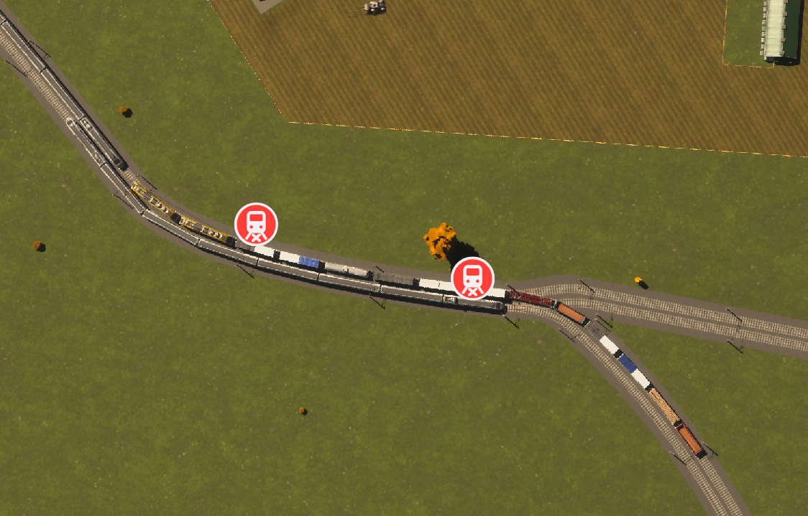

# Bottlenecks

A Cities: Skylines II code mod that finds deadlocked trains, lets you decide what happens to them, flags overloaded cargo stations, and can get a jammed supply chain and post service running again.

- **Paradox Mods:** https://mods.paradoxplaza.com/mods/163289/Windows
- **Feedback and discussion:** [Paradox forum thread](https://forum.paradoxplaza.com/forum/threads/bottlenecks-a-cs2-mod-for-jammed-rail-and-cargo-networks-fixes-issues-with-post-services.1945897/)



## Features

**Trains** (passenger and cargo trains, trams, subways):
- 🔴 **Deadlock:** trains blocking each other are found the moment the game would despawn them. Hold them on the track while you fix the layout, pause the game, or let the game despawn them and mark the spot.
- 🟠 **Blocked:** a train held at a signal, junction or crossing for a long time.
- 🟢 **Queue:** a train waiting a while for a busy station platform.
- 🔔 **Notification cards** that move the camera to the problem.

Some deadlocks are left to the game, as in vanilla: a train blocked by a parked train (the game removes the parked train), and empty trains that get stuck right after leaving their depot or yard.

**Cargo stations, harbours and cargo airports:**
- 🔵 **Not selling:** the station's truck queue has been too long for a while, so companies buy elsewhere. Not critical.
- 🟠 **Overloaded:** the station's trucks are falling behind.
- 🔴 **Backlogged:** a runaway backlog that won't clear by itself. It also stops mail to and from the outside, which takes the post service down.
- **Reset cargo transfers** (Options): clears a runaway backlog. Fix the cause first and save before using it, because goods in queued trips are lost.

Hover any icon in the building's info panel for an explanation.

## Reporting bugs

Please post in the forum thread or open an issue. Describe what you saw and, if possible, attach the mod's log file:

```
%USERPROFILE%\AppData\LocalLow\Colossal Order\Cities Skylines II\Logs\Bottlenecks.Mod.log
```

For crashes, `Player.log` in the folder above helps as well.

## Building from source

Requirements:
- Cities: Skylines II (developed against game version 1.6.2)
- The Cities: Skylines II modding toolchain, installed from the game's options. It sets the `CSII_*` environment variables the project uses.
- .NET SDK

```
dotnet build Bottlenecks/Bottlenecks.csproj -c Release
```

The build deploys the mod to your local Mods folder (`...\Cities Skylines II\Mods\Bottlenecks`). Close the game before building. If you also subscribe to the published version, disable it, or both copies load.

Project layout:
- `Bottlenecks/Mod.cs`: entry point and system registration
- `Bottlenecks/Setting.cs`: options page and English texts
- `Bottlenecks/Systems/`: the simulation systems (deadlock holding, train and cargo icons, despawn markers, cargo reset, optional diagnostics)
- `Bottlenecks/Icons/`: icon sources (SVG) and the embedded PNGs

## License

The code and the icon artwork are released under the [MIT License](LICENSE).

This is a fan-made mod, not affiliated with or endorsed by Paradox Interactive or Colossal Order. Cities: Skylines II and the game content shown in the screenshots belong to their respective owners.
